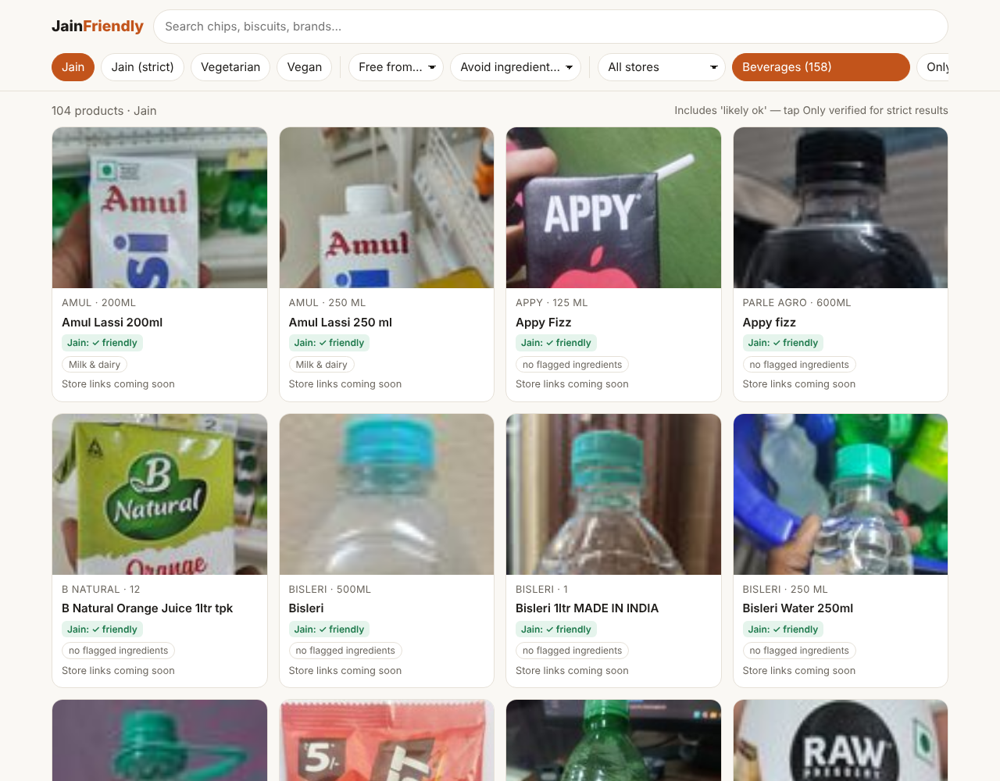

# JainFriendly

**Browse packaged food by what's inside it.** JainFriendly gathers products from many sources, reads each ingredient list, and tags what it contains (onion, potato, carrot, milk, gelatin…) and what it *might* contain hidden inside generic ingredients ("seasoning", "natural flavour", INS 631). Users filter the whole catalogue by diet (Jain, strict Jain, vegetarian, vegan), allergens, or specific ingredients, and see where each product is sold.



## How it fits together

```
 sources (connectors)              catalogue                         users
 ─────────────────────            ───────────────────────          ───────────────────────
 Open Food Facts India  ─┐        match by barcode / brand+name     browse & search
 platform / affiliate   ─┼─────▶  merge offers per platform  ─────▶  filter: Jain, vegan,
   feeds (CSV/JSON)      │        analyse ingredients → tags         free-from, avoid onion…
 manufacturer data     ─┘        verdicts per diet & allergen       where to buy + evidence
```

- **Connectors** (`jainfriendly/catalog/connectors/`) turn a source into products and offers. Open Food Facts works today. The **feed importer** takes CSV/JSON from affiliate programmes, brand catalogues or platform data-sharing.
- **Matching:** one product per barcode, falling back to brand + name + pack size, so the same chips on Blinkit and Zepto become one product with two offers. If sources disagree on ingredients, the most trusted source wins (manufacturer > platform > feed > Open Food Facts).
- **Analysis** runs at import and again whenever the knowledge base changes (`reanalyze`).

### Platforms

| Platform | Status | Legitimate data route |
|---|---|---|
| Zepto, Blinkit, Swiggy Instamart | feed import ready | Partnership / catalogue sharing (no public API; prices and stock depend on pincode) |
| BigBasket | feed import ready | Partnership / affiliate feed |
| Amazon India | feed import ready | Associates + Product Advertising API (links and prices, no ingredients) |
| Flipkart | feed import ready | Affiliate API product feeds (links and prices, no ingredients) |

I chose not to build scrapers for these platforms. Their terms forbid it, and it would undermine the goal of selling this API to the same platforms.

## Why tags first

A yes/no "Jain ✅" badge isn't trustworthy on its own: Jain practice varies (dry ginger, yeast, brinjal), and labels hide things. So the engine works in two layers:

1. **Tags.** Ingredient text becomes tags, each with a status:
   - `present`: listed on the label (*Onion*, from "Seasoning › Onion Powder").
   - `possible`: could be hidden in a generic ingredient, with a likelihood (high/medium/low) and the reason (*Meat (medium)*, from "INS 631: traditionally from meat or fish").
   - `trace`: from "May contain…" or "Made in a facility that also handles…".
2. **Profiles.** Jain, vegan and the rest are rules over tags. Users can adjust them, for example to allow dry ginger and yeast or to avoid brinjal. The same tags work for any diet or allergy.

Verdicts: `friendly` · `likely_friendly` (only low-likelihood possibilities, traces, or unrecognised ingredients) · `unclear` (something avoided may be hidden) · `not_friendly`.

## Quick start

```bash
scripts/setup.sh     # local venv + deps; builds data/catalog.db from the committed seed snapshot
scripts/run.sh       # http://localhost:8000
```

Manually:

```bash
pip install -e ".[dev]"
python -m jainfriendly.catalog load seed/catalog.jsonl.gz       # ~940 products, offline
python -m jainfriendly.catalog sync-off --pages 10     # or import fresh from Open Food Facts
python -m jainfriendly.catalog import-feed offers.csv --platform blinkit   # add store offers
uvicorn jainfriendly.api:app                            # http://localhost:8000 (catalogue), /check, /docs
pytest
```

Other catalogue commands: `barcode <ean>…`, `reanalyze`, `stats`, `todo` (the most common unrecognised ingredients, i.e. what to add to the lexicon next).

### Ingredient checker and analysis API

```bash
python -m jainfriendly "Potato, palm oil, seasoning (salt, onion powder), INS 631" -p jain
```

Catalogue API: `GET /v1/products?diet=jain&free_from=peanut&avoid=onion&platform=blinkit&category=…&strict=true&q=…`, `GET /v1/products/{id}`, `GET /v1/catalog`, `GET /v1/platforms`.

### API

```http
POST /v1/analyze
{
  "ingredients": "Gram flour, oil, salt, spices (chilli, dry ginger), asafoetida",
  "profiles": ["vegan", {"id": "jain", "options": {"yeast": true}}, "allergen:peanut"],
  "veg_mark": "green"            // optional FSSAI green/brown dot
}
```

Returns `tags` (with evidence), `contains` / `may_contain` / `traces`, `unrecognized`, and per-profile `verdict`, `violations`, `uncertain`, `caveats`, `allowed_by_preference` and `not_detected`.

`POST /v1/analyze/batch` takes up to 1,000 products per call and returns compact verdicts, for filtering a whole catalogue. `GET /v1/profiles` and `GET /v1/tags` describe the profiles and the taxonomy.

## Profiles

| id | Avoids |
|---|---|
| `jain` | Roots, tubers and bulbs (onion, garlic, potato, carrot, beetroot, tapioca…), meat, fish, egg, slaughter by-products, insect-derived (carmine, shellac), honey, mushrooms, alcohol. **Options (off by default):** dry ginger/turmeric, yeast, fermented, many-seeded (brinjal, fig), dairy. |
| `jain_strict` | `jain` with all options on. |
| `vegetarian` | Indian lacto-vegetarian (FSSAI definition): no meat, fish, egg, gelatin, animal rennet, carmine… |
| `vegan` | Vegetarian, plus dairy, honey and beeswax. |
| `allergen:<x>` | gluten, milk, egg, fish, crustacean, mollusc, peanut, tree_nut, soy, sesame, mustard, sulphite, celery, lupin. Traces count as "unclear". |

## Knowledge base

Everything is plain, reviewable YAML in [`jainfriendly/data/`](jainfriendly/data):

- `tags.yaml`: tags and groups (the taxonomy).
- `lexicon.yaml`: about 1,250 label phrases, including Hindi names (pyaz, lahsun, aloo, sonth, hing).
- `additives.yaml`: about 230 INS/E codes, flagging those that may be animal-, insect- or root-derived.
- `profiles.yaml`: diet rules.

The loader rejects unknown tags, duplicate phrases, uncited "possible" entries and malformed fields. See [docs/METHODOLOGY.md](docs/METHODOLOGY.md) for how decisions are made and how to contribute.

## Data licence

Open Food Facts data is under the [Open Database License](https://opendatacommons.org/licenses/odbl/1-0/), and its images under CC BY-SA. The app shows attribution on every page. A public database built from it must stay ODbL. Your own analysis and code can be licensed however you choose.

## Roadmap

- [ ] Read ingredients from product photos (OCR), to fill the ~25% of products that have a photo but no ingredient text.
- [ ] Platform data: affiliate feeds (Amazon, Flipkart) for links and prices; data-sharing pilots with a quick-commerce platform.
- [ ] Pincode-aware availability for quick-commerce.
- [ ] Review the Jain rulebook with Jain scholars and community bodies; publish it.
- [ ] Manufacturer attestation flow, so brands can confirm what is inside "seasoning" and "flavour" and earn a "verified" status.
- [ ] Log unrecognised ingredients across many products and use the counts to decide what to add to the lexicon next.
- [ ] More profiles: Swaminarayan, sattvic, Navratri/vrat, halal-sensitive, low-FODMAP.
