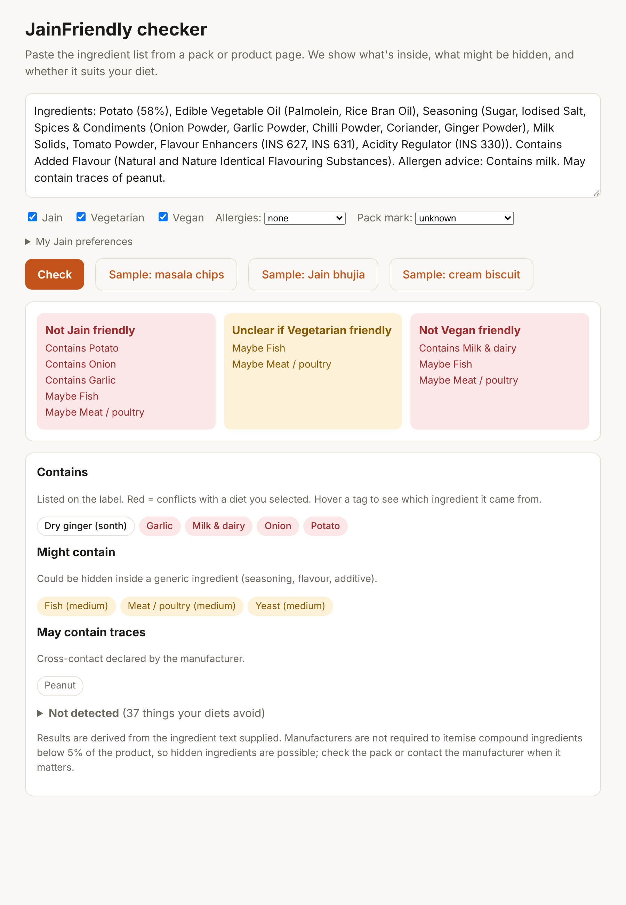

# JainFriendly

**Know what's inside packaged food.** JainFriendly reads an ingredient list and tags what it contains (onion, potato, carrot, milk, gelatin...), what it *might* contain hidden inside generic ingredients ("seasoning", "natural flavour", INS 631), and checks the result against Jain, vegetarian, vegan and allergen profiles. Every result shows the ingredient that caused it.



## Why tags first

A yes/no "Jain ✅" badge isn't trustworthy on its own: Jain practice varies (dry ginger, yeast, brinjal), and labels hide things. So the engine works in two layers:

1. **Tags.** Ingredient text becomes tags, each with a status:
   - `present`: listed on the label (*Onion*, from "Seasoning › Onion Powder").
   - `possible`: could be hidden in a generic ingredient, with a likelihood (high/medium/low) and the reason (*Meat (medium)*, from "INS 631: traditionally from meat or fish").
   - `trace`: from "May contain…" or "Made in a facility that also handles…".
2. **Profiles.** Jain, vegan and the rest are rules over tags. Users can adjust them, for example to allow dry ginger and yeast or to avoid brinjal. The same tags work for any diet or allergy.

Verdicts: `friendly` · `likely_friendly` (only low-likelihood possibilities, traces, or unrecognised ingredients) · `unclear` (something avoided may be hidden) · `not_friendly`.

## Quick start

```bash
pip install -e ".[dev]"
pytest                                    # run the tests
uvicorn jainfriendly.api:app --reload     # open http://localhost:8000 for the demo, /docs for the API
python -m jainfriendly "Potato, palm oil, seasoning (salt, onion powder), INS 631" -p jain
```

### API

```http
POST /v1/analyze
{
  "ingredients": "Gram flour, oil, salt, spices (chilli, dry ginger), asafoetida",
  "profiles": ["vegan", {"id": "jain", "options": {"yeast": true}}, "allergen:peanut"],
  "veg_mark": "green"            // optional FSSAI green/brown dot
}
```

Returns `tags` (with evidence), `contains` / `may_contain` / `traces`, `unrecognized`, and per-profile `verdict`, `violations`, `uncertain`, `caveats`, `allowed_by_preference` and `not_detected`.

`POST /v1/analyze/batch` takes up to 1,000 products per call and returns compact verdicts, for filtering a whole catalogue. `GET /v1/profiles` and `GET /v1/tags` describe the profiles and the taxonomy.

## Profiles

| id | Avoids |
|---|---|
| `jain` | Roots, tubers and bulbs (onion, garlic, potato, carrot, beetroot, tapioca…), meat, fish, egg, slaughter by-products, insect-derived (carmine, shellac), honey, mushrooms, alcohol. **Options (off by default):** dry ginger/turmeric, yeast, fermented, many-seeded (brinjal, fig), dairy. |
| `jain_strict` | `jain` with all options on. |
| `vegetarian` | Indian lacto-vegetarian (FSSAI definition): no meat, fish, egg, gelatin, animal rennet, carmine… |
| `vegan` | Vegetarian, plus dairy, honey and beeswax. |
| `allergen:<x>` | gluten, milk, egg, fish, crustacean, mollusc, peanut, tree_nut, soy, sesame, mustard, sulphite, celery, lupin. Traces count as "unclear". |

## Knowledge base

Everything is plain, reviewable YAML in [`jainfriendly/data/`](jainfriendly/data):

- `tags.yaml`: tags and groups (the taxonomy).
- `lexicon.yaml`: about 1,250 label phrases, including Hindi names (pyaz, lahsun, aloo, sonth, hing).
- `additives.yaml`: about 230 INS/E codes, flagging those that may be animal-, insect- or root-derived.
- `profiles.yaml`: diet rules.

The loader rejects unknown tags, duplicate phrases, uncited "possible" entries and malformed fields. See [docs/METHODOLOGY.md](docs/METHODOLOGY.md) for how decisions are made and how to contribute.

## Roadmap

- [ ] Read ingredient lists from product photos (OCR), plus a browser extension or share-sheet for Blinkit, Zepto and Amazon pages.
- [ ] Product database keyed by barcode/EAN, seeded from Open Food Facts India, with verified results and version history.
- [ ] Review the Jain rulebook with Jain scholars and community bodies; publish it.
- [ ] Manufacturer attestation flow, so brands can confirm what is inside "seasoning" and "flavour" and earn a "verified" status.
- [ ] Log unrecognised ingredients across many products and use the counts to decide what to add to the lexicon next.
- [ ] More profiles: Swaminarayan, sattvic, Navratri/vrat, halal-sensitive, low-FODMAP.
